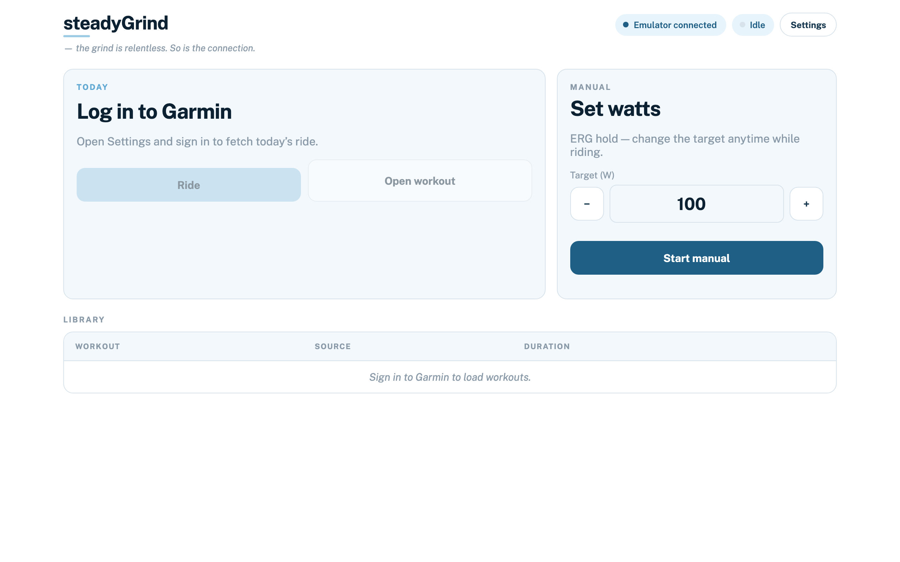
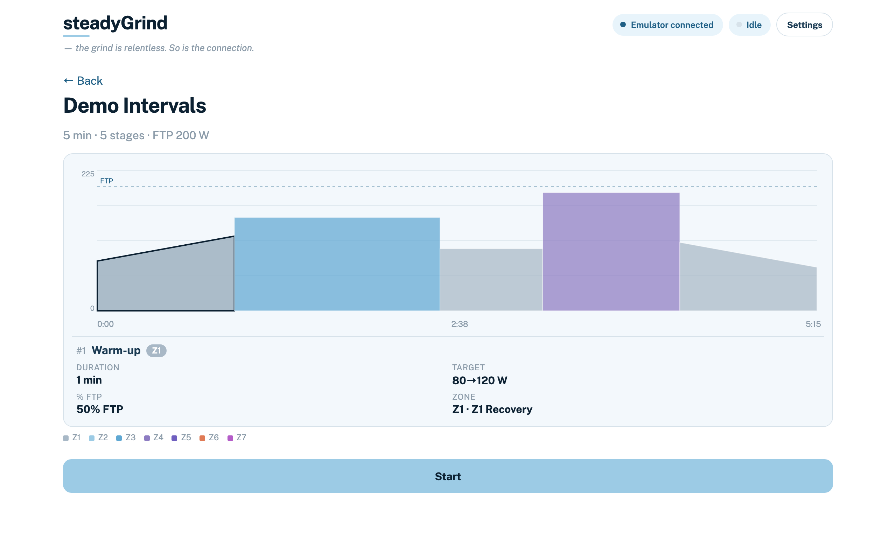
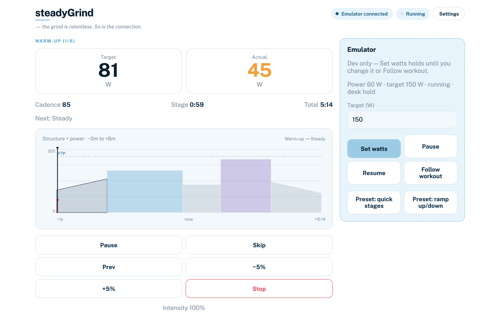
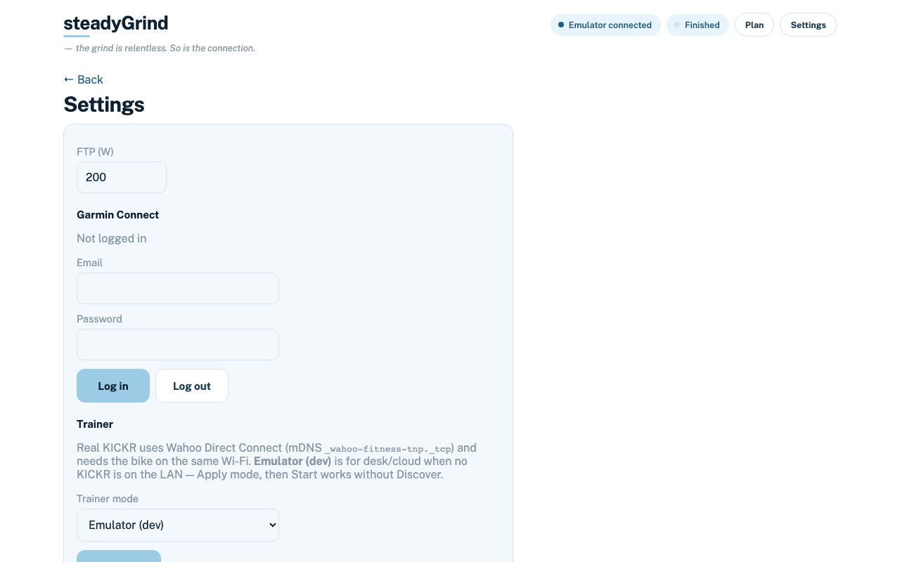
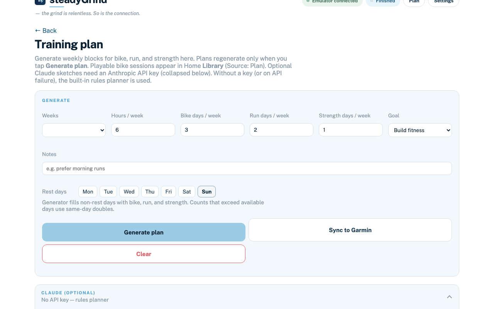
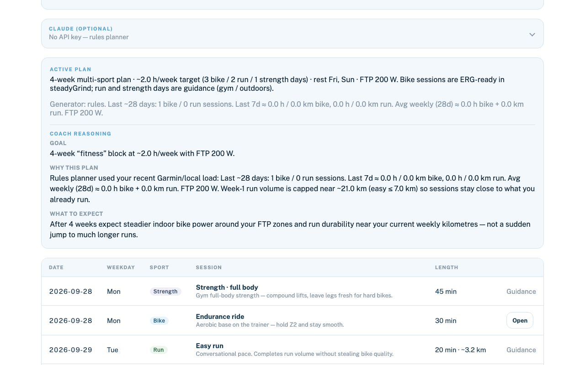

# steadyGrind

Self-hosted macOS and Windows 11 app that runs Garmin Connect workouts on a Wahoo KICKR v6 over Wi-Fi.

See [specification/SPEC.md](specification/SPEC.md) for the full software spec (kept current with shipped behaviour).

## Why?

I wanted a free and stable way to ride indoors. Garmin’s ANT+ link is not steady enough to control the trainer. A Wi-Fi connection is much more stable, and a Garmin device still records the session. Garmin also has no duathlon training plan. steadyGrind builds one with AI from Garmin Connect history.

## What's new (v1.4.0)

- **Next 10 minutes.** During a structured ride the chart starts at 0 and grows the past until 10 minutes are on screen. The upcoming segments stay on the right, labeled with name and target.
- **Workout length.** Home and the ride total use the parsed stage length, shown in hours and minutes.

Full notes: [CHANGELOG](CHANGELOG.md) · [What's New](dist/latest/WHAT_IS_NEW.md)


## Screenshots

Stills are 1280×800 (half the previous retina size).

Home — library, with a pale sketch of each workout:



Workout preview — zone-coloured power profile:



Ride — next 10 minutes of the workout:



Settings — Garmin, trainer mode, Autoconnect:



Plan — weeks / hours / bike·run·strength days, rest chips, optional Claude:



Plan active — coach reasoning and multi-sport calendar:



Refresh stills (Emulator, no KICKR needed):

```bash
uv run python .cursor/skills/readme-screenshots/scripts/capture_readme_screenshots.py
```

## Phase A – run on macOS (dev)

```bash
# Requires Python 3.11+ (uv installs one if needed)
curl -LsSf https://astral.sh/uv/install.sh | sh   # once
source ~/.local/bin/env

cd HomeWlanTrainer
uv sync --extra ble
./deploy/macos/run.sh
```

The **steadyGrind** window opens from this repo (no browser toolbar). Run the script again to restart: the previous steadyGrind on port 8080 stops, and the window loads a fresh page. **View → Reload** (Command-R) refreshes the page without a full restart. From a phone on the same LAN, open **http://\<mac-name\>.local:8080**.

Allow **Local Network** access when macOS prompts (needed for KICKR mDNS discovery).

## Phase A – run on Windows 11 (dev)

```powershell
# Requires Python 3.11+ and uv (https://docs.astral.sh/uv/)
cd HomeWlanTrainer
uv sync --extra ble
.\deploy\windows\run.ps1
```

A tray icon appears and the **steadyGrind** WebView2 window opens (Edge WebView2 Runtime; falls back to the default browser). Run the script again to restart on port 8080. From a phone on the same LAN, use **Copy phone URL** in the tray menu (or `http://<pc-name>:8080`). Allow the Windows Firewall prompt so the phone can reach the UI.

### Trainer emulator (desk development)

To exercise the app without a physical KICKR:

1. Open **Settings**.
2. Set **Trainer mode** to **Emulator (dev)** → **Apply mode**.
3. Use the Emulator panel: Set watts, Pause/Resume, or run a short preset (`quick_stages`, `ramp_up_down`).
4. Start **Manual** or a Garmin workout as usual — live power comes from the emulator.

Or via env (overrides a prior Real KICKR session saved in Settings for this process):

```bash
KICKR_TRAINER_MODE=simulated ./deploy/macos/run.sh
```

Windows (PowerShell):

```powershell
$env:KICKR_TRAINER_MODE="simulated"; .\deploy\windows\run.ps1
```

(`KICKR_ALLOW_SIMULATED=true` is implied when the mode is `simulated`; set `KICKR_ALLOW_SIMULATED=false` to force Real KICKR.)

Leave mode on **Real KICKR** for normal riding. Emulator APIs return 404 when DirCon is active.

## Share with a friend (macOS DMG installer)

**Download the latest DMG** (Apple silicon, v1.4.0):

```bash
curl -fL -o steadyGrind-1.4.0-macos.dmg \
  https://github.com/attilameget/HomeWlanTrainer/releases/download/v1.4.0/steadyGrind-1.4.0-macos.dmg
```

Also in the repo: [`dist/latest/`](dist/latest/) ([DMG](https://github.com/attilameget/HomeWlanTrainer/raw/main/dist/latest/steadyGrind-1.4.0-macos.dmg)).

Rebuild locally (output goes to `dist/latest/`; older builds move to `dist/previous-builds/<version>/`; runs unit + e2e tests first):

```bash
./deploy/macos/build_dmg.sh
```


**On your friend's Mac**

1. Open the DMG and drag **steadyGrind** onto **Applications** in that window.
2. First launch: right-click → **Open** (unsigned / Gatekeeper).
3. A menu-bar item (**● SG**) appears and the **steadyGrind** window opens (no browser toolbar). **Open at Login** is on by default and does not open that window until you choose **Open UI**. Same Wi‑Fi as the KICKR; allow Local Network if asked. Allow Bluetooth to connect a heart-rate strap.
4. From a phone: menu bar → **Copy phone URL** (or `http://<mac-name>.local:8080`).
5. Settings → Garmin Connect to fetch today's bike workout.
6. Menu bar → **Quit** when done (server stops for this session; it still starts at the next login while Open at Login is checked).

Server log: `~/Library/Logs/steadyGrind/server.log`.

App-only build (no DMG): `./deploy/macos/build_app.sh` → `dist/steadyGrind.app`.

## Share with a friend (Windows 11 portable zip)

**Download the latest zip** (x64, v1.3.6):

```powershell
Invoke-WebRequest -Uri https://github.com/attilameget/HomeWlanTrainer/raw/main/dist/latest/steadyGrind-1.3.6-windows.zip -OutFile steadyGrind-1.3.6-windows.zip
```

Also in the repo: [`dist/latest/steadyGrind-1.3.6-windows.zip`](dist/latest/steadyGrind-1.3.6-windows.zip).

Rebuild locally (runs unit + e2e first), or use the **Windows zip** GitHub Action:

```powershell
.\deploy\windows\build_zip.ps1
```

**On your friend's PC**

1. Unzip somewhere permanent and double-click **steadyGrind.exe** (or **Start steadyGrind.cmd**).
2. A tray icon appears; the steadyGrind window opens via Edge WebView2 (install the [WebView2 Runtime](https://developer.microsoft.com/microsoft-edge/webview2/) if prompted).
3. **Open at Login** is on by default for packaged builds. Same Wi‑Fi as the KICKR; allow the firewall if asked. Allow Bluetooth for a heart-rate strap.
4. From a phone: tray → **Copy phone URL**.
5. Tray → **Quit** when done.

Server log: under the steadyGrind user log folder (typically `%LOCALAPPDATA%\steadyGrind\Logs\server.log`).

## Tests

Unit / API:

```bash
uv run pytest
```

UI end-to-end (Emulator; not part of the shipped app — see [`e2e/README.md`](e2e/README.md)):

```bash
uv sync --group dev
uv run playwright install chromium
uv run pytest e2e -q
```

## Claude (optional plan sketches)

On the **Plan** page, paste an Anthropic API key (from [console.anthropic.com](https://console.anthropic.com/)). Generate then prefers Claude for the week sketch; ERG stages stay on-host. Leave the key empty (or on API failure) and the built-in rules planner is used. You can also set `KICKR_ANTHROPIC_API_KEY` / `KICKR_ANTHROPIC_MODEL` in the environment.

The key is stored only on the host (Settings / SQLite or env). Do **not** commit `.env` files or real keys — this repository is public.
